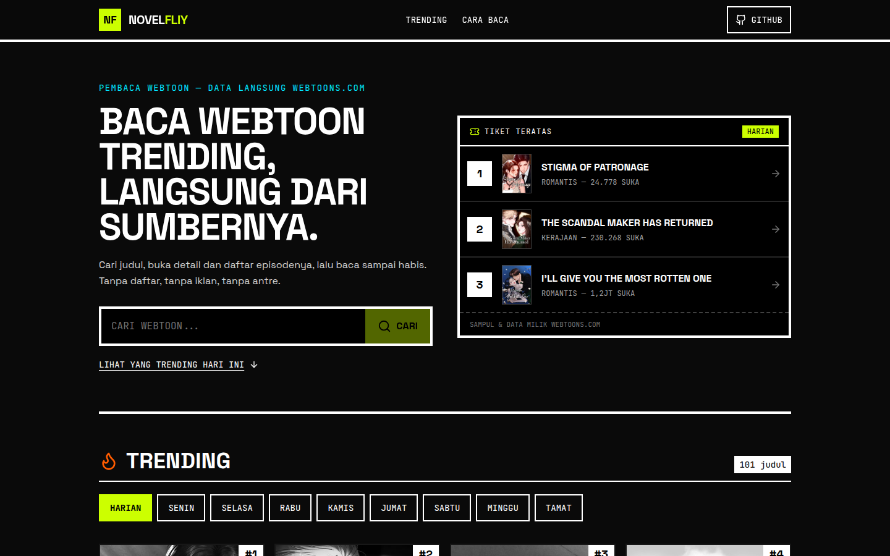
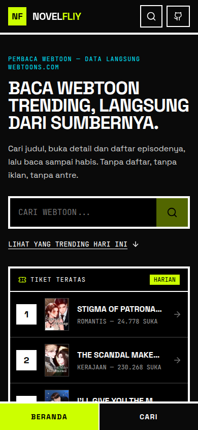
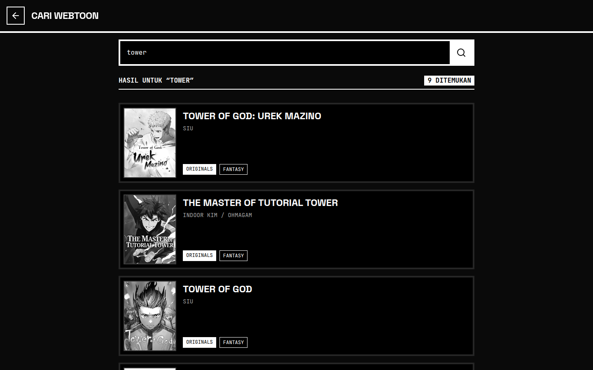
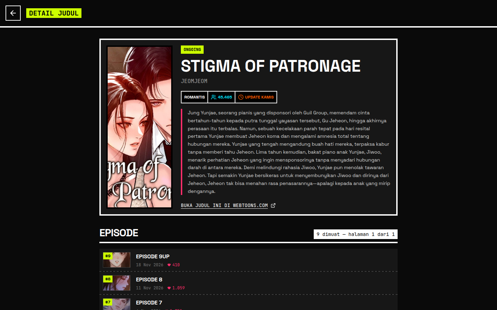
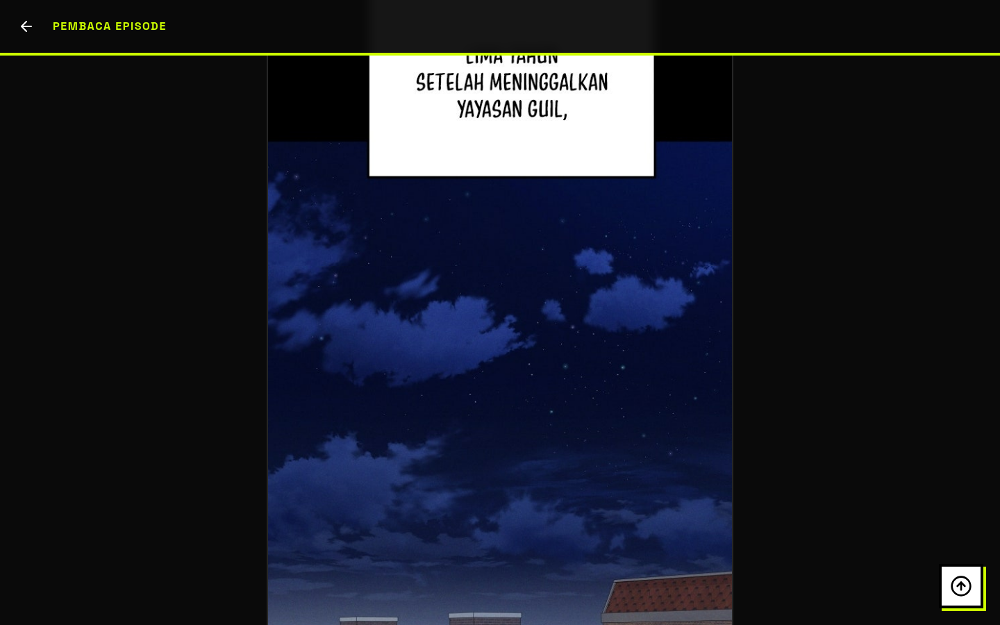

# NovelFliy

Pembaca webtoon brutalist — cari judul, lihat detail dan daftar episode,
lalu baca webtoon trending langsung dari sumbernya (webtoons.com).
Tanpa daftar, tanpa iklan.

## Live Demo

**https://novelfliy.pages.dev**

> Nama final mengikuti hasil create-project (lihat `docs/deploy.md`).
> `novel-fliy` ternyata dipakai akun Cloudflare lain (HTTP 409),
> fallback `novelfliy` dipakai dan live di https://novelfliy.pages.dev.

## Tampilan







Video demo: [docs/demo/demo.mp4](docs/demo/demo.mp4) (rangkaian screenshot,
5 detik per adegan).

## Fitur

| Fitur | Cara pakai |
|---|---|
| Trending harian & per hari | Tab Harian / Senin–Minggu / Tamat di beranda — 101 judul harian saat diuji |
| Cari webtoon | Ketik judul di kolom pencarian (beranda atau `/search`) |
| Detail judul | Sinopsis, genre, penulis, status, rating, subscriber — dari halaman judul webtoons.com |
| Daftar episode | Pagination "Muat episode berikutnya", nomor + tanggal + likes per episode |
| Pembaca episode | Gulir vertikal halaman gambar, tombol kembali ke atas |
| Proxy gambar | `/api/image-proxy` — sampul & halaman dimuat lewat server (anti-hotlink) |

Semua data diambil live dari webtoons.com lewat CORS proxy publik
(`cors.siputzx.my.id`). Kalau upstream tidak menjawab, halaman menampilkan
pesan gagal yang jujur — bukan data palsu.

## Cara jalan

```bash
npm install
npm run dev        # http://localhost:3000
```

Build produksi + jalankan:

```bash
npm run build
npx next start -p 8331
```

## Tech stack

- **Next.js 15.5** (App Router) + React 19 + Tailwind CSS 4
- **cheerio** — parsing HTML webtoons.com (server-side, di Route Handler)
- **fetch bawaan** — tanpa axios, supaya lib scraper jalan di Node maupun
  di Workers (Cloudflare Pages via `@opennextjs/cloudflare`)
- **lucide-react** — ikon SVG; **Space Grotesk + JetBrains Mono** — tipografi

## Struktur

```
app/                  # App Router: /, /search, /detail, /read + /api/*
  api/trending/       # GET ?day=daily|monday|...|completed
  api/search/         # GET ?q=
  api/detail/         # GET ?url= (hanya webtoons.com)
  api/episodes/       # GET ?url=&page=
  api/read/           # GET ?url= (daftar gambar episode)
  api/image-proxy/    # GET ?url= (allowlist host gambar webtoon)
  api/status/         # GET status ringan
lib/webtoons-api.ts   # scraper + tipe (WebtoonItem, EpisodeItem, ...)
public/              # manifest.json, sw.js (PWA)
scripts/             # advisory-sweep.py, check-static.mjs, smoke.mjs,
                     # screenshot.mjs, make-video.mjs
e2e/                 # Playwright e2e (desktop + mobile)
docs/                # PRD, arsitektur, desain, API, deploy, testing, diagram
```

## Keamanan

- **Tanpa secret**: tidak ada API key / kredensial di repo maupun di kode.
  Scraper tidak memakai login apa pun.
- **Validasi input**: `url` di `/api/detail|episodes|read` harus dari
  `webtoons.com` (selain itu 400); `day` di `/api/trending` harus dari
  daftar yang diizinkan; `image-proxy` hanya meneruskan host
  `webtoons.com` / `*.pstatic.net` (anti-SSRF).
- **Sweep dependensi**: `npm run sweep` (OSV batch, tanpa auth) — produksi
  bersih dari HIGH/CRITICAL.

## Pengujian

```bash
npm run typecheck   # tsc --noEmit
npm run lint        # eslint (FlatCompat, next/core-web-vitals)
npm run validate    # gate anti-slop P0 + secret scan
npm run sweep       # OSV advisory sweep (produksi)
npm test            # Playwright e2e, 16 tes (desktop + mobile)
npm run smoke       # smoke build produksi (butuh `npm run build` dulu)
npm run screenshots # screenshot docs (butuh server di :8331)
npm run make-video  # docs/demo/demo.mp4 dari screenshot
```

Lihat `docs/testing.md` untuk detail.

## Deploy

Cloudflare Pages via `@opennextjs/cloudflare` (Worker + aset statis).
Lihat `docs/deploy.md`.

## Desain

Kontrak arah desain (referensi, palet, tipografi, detail khas):
`docs/DESIGN.md` — referensi pemenang **Now Serving** (Framer,
neo-brutalist, motif tiket):
https://www.framer.com/marketplace/templates/now-serving/

## Lisensi

MIT — lihat [LICENSE](./LICENSE).

---

_Dikembangkan oleh **dezzorigin** (Nabil Aulia Dika)._
